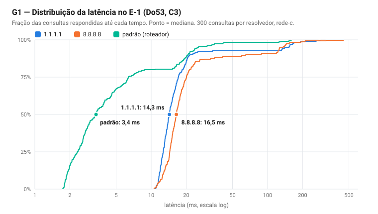
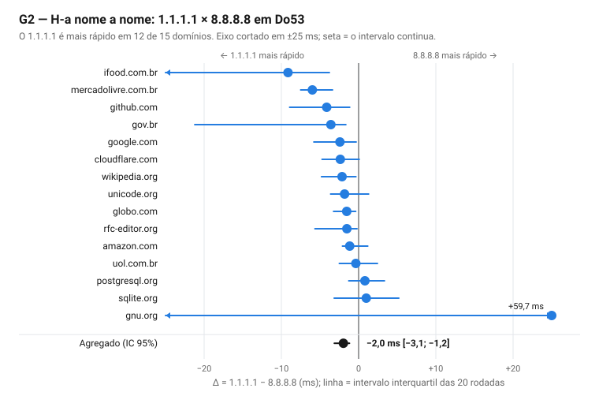
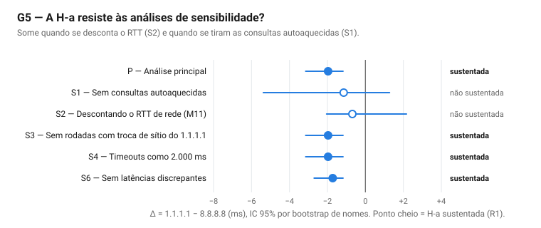
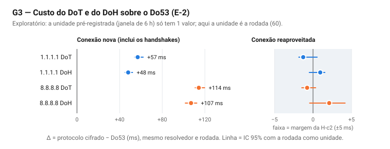
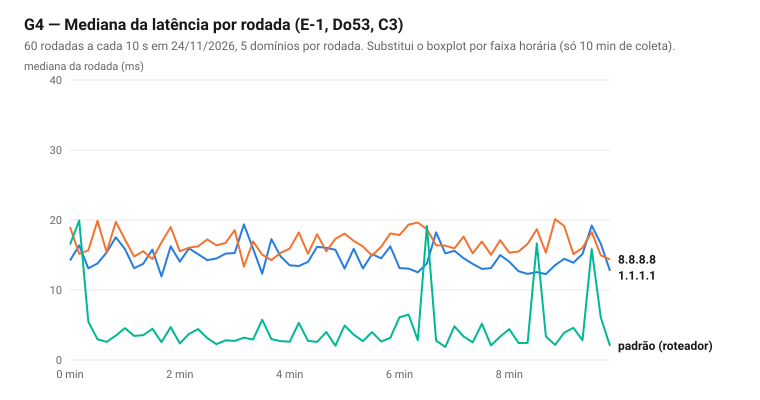

# Lab05 — Resultados consolidados da Sprint 02

Issues #136 (testes de hipótese e tamanho do efeito) e #137 (visualizações e
consolidação). Este texto **interpreta**. Os números saem de três arquivos
gerados, que a CI confere a cada push:

| Arquivo | Gerado por | O que tem |
| --- | --- | --- |
| [`analise_rede-c.md`](analise_rede-c.md) | `Sprint01/coleta/analise.py` | Descritiva, Friedman, Wilcoxon, falhas, covariáveis |
| [`testes_hipotese.md`](testes_hipotese.md) | [`../inferencia.py`](../inferencia.py) | Vereditos, tamanhos de efeito, Δ por nome, E-2 exploratório, sensibilidade |
| [`graficos/`](graficos/) | [`../graficos.py`](../graficos.py) | G1 a G5, em SVG |

**Dados.** Pela decisão D13, a base é a coleta da **rede-c** de 24/11/2026
(lote `provisoria` da [base validada](../base_validada/README.md)): 1.500
consultas, 60 rodadas a cada 10 s, ≈ 10 minutos, 0 exclusões, 0 falhas. Tudo o
que vem abaixo vale **para essa rede, naqueles 10 minutos**.

---

## 1. Respostas curtas

| Pergunta | Resposta | Força da evidência |
| --- | --- | --- |
| **Q1** — o 1.1.1.1 é mais rápido que o 8.8.8.8 em Do53? | Sim, por **2,0 ms** na mediana (IC 95% [−3,1; −1,2]), em 12 de 15 domínios. **Mas a diferença é do tamanho da diferença de RTT**, e some quando se desconta a distância (S2). | H-a **sustentada** no teste primário; **frágil** na sensibilidade |
| **Q1** — e contra o resolvedor padrão? | O padrão (o roteador, que encaminha e guarda cache) é **10,4 ms mais rápido** que o 1.1.1.1 (IC [+9,3; +11,4]) | Forte nesta rede, mas é "cache local × acesso direto", não um resolvedor contra outro |
| **Q2** — e com cache controlado? | Não respondida: sem a zona do grupo (D1) não houve C1 nem C2 | — |
| **Q3** — quanto custam DoT e DoH? | Com **conexão nova**, +48 a +57 ms no 1.1.1.1 e +107 a +114 ms no 8.8.8.8. Com **conexão reaproveitada**, entre −1,3 e +2,1 ms, dentro da margem de ±5 ms | **Exploratória**: a unidade pré-registrada (janela de 6 h) só tem 1 valor |
| **Q4** — confiabilidade? | 0 falhas em 1.500 consultas; IC de Wilson até 0,64% por resolvedor público | Descritiva; 10 minutos não medem eventos raros |

---

## 2. Q1 e H-a — 1.1.1.1 × 8.8.8.8 × padrão (E-1, Do53, C3)



**G1.** A curva do 1.1.1.1 fica à esquerda da do 8.8.8.8 em quase toda a
distribuição, com uma diferença pequena e constante, e as duas se cruzam
na cauda (p95 de 144,8 × 133,8 ms). O padrão responde metade das consultas em
até 3,4 ms. Isso é tempo de rede local: o roteador responde do próprio cache.
Os ≈ 10% mais lentos dos dois públicos são recursões de 100 a 300 ms, as
consultas em que a resposta não estava em cache.

| Resolvedor | Mediana (ms) | p95 (ms) | IQR/mediana | RTT mediano (ms) |
| --- | --- | --- | --- | --- |
| 1.1.1.1 | 14,3 | 144,8 | 0,31 | 30,0 |
| 8.8.8.8 | 16,5 | 133,8 | 0,34 | 32,0 |
| padrão (roteador) | 3,4 | 25,1 | 1,20 | 16,1 |

### Testes e tamanho do efeito

O **Friedman** sobre os 15 nomes rejeita a igualdade dos três resolvedores
(Q = 20,9, gl = 2, p = 2,8 × 10⁻⁵). O **W de Kendall = 0,70** indica que os nomes
concordam bastante na ordem: padrão, depois 1.1.1.1, depois 8.8.8.8.

| Comparação | Δ mediano | IC 95% | p (Holm) | r | δ de Cliff | Vitórias do 1.1.1.1 |
| --- | --- | --- | --- | --- | --- | --- |
| 1.1.1.1 − 8.8.8.8 | **−2,0 ms** (−12%) | [−3,1; −1,2] | 0,022 | 0,59 grande | +0,64 grande | 71% [61%; 80%] |
| 1.1.1.1 − padrão | **+10,4 ms** (+310%) | [+9,3; +11,4] | 0,0002 | 0,87 grande | −0,88 grande | 14% [7%; 23%] |

**Efeito "grande" não quer dizer diferença grande.** r e δ de Cliff medem
**consistência**, ou seja, com que frequência um resolvedor ganha do outro. O
tamanho da diferença está no Δ. O 1.1.1.1 ganha do 8.8.8.8 com muita
regularidade (71% dos blocos decididos), mas por 2 ms. Para quem usa, 2 ms numa
resolução DNS não se percebem.

### Nome a nome



**G2.** O 1.1.1.1 vence em 12 dos 15 domínios. Os três em que perde
(`postgresql.org`, `sqlite.org`, `gnu.org`) são os mesmos de cauda longa que
inverteram no piloto (PlanoDeAnalise, seção 2). `gnu.org` perde por +59,7 ms
na mediana, com IQR de −29 a +139 ms. Quem respondeu de cache naquela rodada
ganhou, e o cache de `gnu.org` (TTL 300 s) não estava sempre quente no PoP do
1.1.1.1. É a recursão que o C1 isolaria, se houvesse zona.

---

## 3. A H-a resiste? Análises de sensibilidade (10.6)



| Cenário | Δ 1.1.1.1 − 8.8.8.8 | IC 95% | p (Holm) | H-a |
| --- | --- | --- | --- | --- |
| P — principal | −2,0 | [−3,1; −1,2] | 0,022 | sustentada |
| S1 — sem consultas autoaquecidas (168 de 900) | −1,1 | [−5,4; +1,3] | 0,46 | **não sustentada** |
| S2 — descontando o RTT (M11) | −0,7 | [−2,0; +2,2] | 0,93 | **não sustentada** |
| S3 — sem troca de sítio do 1.1.1.1 | igual a P | | | sustentada (0 trocas: nada a excluir) |
| S4 — timeouts como 2.000 ms | igual a P | | | sustentada (0 falhas: nada a incluir) |
| S5 — sem o estrato enviesado | não se aplica | | | a lista do piloto não tem estratos |
| S6 — sem latências discrepantes | −1,7 | [−2,7; −1,2] | 0,007 | sustentada |

**O que isso diz.**

- **S2 é o achado mais importante da sprint.** O RTT até o 1.1.1.1 ficou 2 ms
  abaixo do RTT até o 8.8.8.8 (30,0 × 32,0 ms), exatamente o Δ observado.
  Descontado o RTT, o tempo de servidor dos dois é indistinguível (Δ −0,7 ms,
  r = 0,03). A vantagem do 1.1.1.1 **nesta rede** vem do caminho de rede até
  o ponto de presença, e não de um servidor mais rápido.
- **S1 mostra o autoaquecimento.** Com uma rodada a cada 10 s, 81% das
  consultas do E-1 chegaram enquanto a resposta da consulta anterior do
  próprio grupo ainda estava no cache. Sem elas sobram 168 consultas, o IC
  quadruplica e a H-a não se sustenta. Isso não prova que o efeito some: com
  essa amostra, o teste não tem poder para mostrar efeito nenhum. Fica a
  ameaça do README do lote confirmada: o cache desta coleta é mais quente que
  o do desenho.
- **S6 reforça o principal.** Os discrepantes (recursões, #134 seção 5) puxam
  para os dois lados, e sem eles o IC fica mais estreito.
- **S2 não vale para o padrão.** O RTT do padrão é o `connect` TCP na porta 53
  do roteador (16 ms). Isso é mais que a própria resposta UDP (3,4 ms), então
  descontá-lo não mede a distância. O −5,6 ms de S2 para 1.1.1.1 − padrão não
  deve ser lido.

**Leitura honesta da H-a:** sustentada pelo critério pré-registrado, mas por
uma diferença de 2 ms explicada pela distância de rede. Ela depende da rede de
coleta e da rota até o PoP, não do resolvedor em si.

---

## 4. Q3 e H-c — o custo do DoT e do DoH (E-2)



**Confirmatório: nada.** A unidade do E-2 é a janela de 6 h (10.2), e os 10
minutos de coleta cabem numa só. H-c1 e H-c2 ficam **não testáveis**, como o
README do lote já previa.

**Exploratório (rodada como unidade, desvio declarado).** As 60 rodadas viram
unidades. Elas estão a 10 s uma da outra e não são independentes, então o IC
sai mais estreito do que deveria. Os números servem para dimensionar o efeito
e planejar a coleta definitiva, não para confirmar.

| Resolvedor | DoT nova | DoH nova | DoT reaproveitada | DoH reaproveitada |
| --- | --- | --- | --- | --- |
| 1.1.1.1 | **+57,0** [+54,2; +62,1] | **+48,1** [+45,2; +52,2] | −1,3 [−1,8; +0,5] | +0,9 [−0,5; +1,5] |
| 8.8.8.8 | **+114,3** [+110,9; +119,7] | **+107,1** [+101,6; +112,4] | −0,8 [−1,5; +0,3] | +2,1 [−0,4; +4,2] |

Δ em ms, protocolo cifrado − Do53, IC 95% com a rodada como unidade.

- **Conexão nova** acrescenta +340% a +400% ao Do53 no 1.1.1.1 e +715% a
  +765% no 8.8.8.8. A diferença entre os dois **não é de rede**: no DoT, o
  handshake TCP leva o mesmo nos dois (mediana de 29 × 31 ms, ≈ 1 RTT), mas o
  handshake TLS 1.3 leva **17 ms no 1.1.1.1 e 69 ms no 8.8.8.8** (colunas
  `t_tcp_ms` e `t_tls_ms`). O custo extra do Google está no servidor TLS, não
  na distância. Em 240 pares (2 resolvedores × 2 protocolos × 60 rodadas), o
  protocolo cifrado com conexão nova ganhou do Do53 **uma vez** (δ de Cliff de
  −0,95 a −1,00).
- **Conexão reaproveitada** fica dentro de ±5 ms nos quatro casos, que é o
  critério R2 da H-c2. Só o DoH do 8.8.8.8 tem IC que encosta em +4,2 ms (δ de
  Cliff −0,36, médio). É o único caso a observar na coleta definitiva.
- **Consequência prática:** o que encarece o DNS cifrado é **abrir** a
  conexão, não cifrar. Um cliente que mantém a conexão aberta (como os
  navegadores) quase não paga nada. M12 sustenta a leitura: 0 reconexões em
  240 medidas com conexão reaproveitada.

---

## 5. Q4 — estabilidade e falhas



**G4** substitui o boxplot por faixa horária pedido na 10.1. Com 10 minutos
de coleta só existe uma faixa, e o boxplot teria uma caixa só. A série mostra
o que dá para ver: os dois públicos estáveis entre 12 e 20 ms em todas as
rodadas, sem degrau, o que é coerente com nenhuma troca de sítio (S3). O
padrão tem alguns picos isolados, que são as rodadas em que o roteador não tinha a
resposta em cache e precisou encaminhar.

**Falhas:** 0 em 600 consultas a cada resolvedor público (IC de Wilson
[0%; 0,64%]) e 0 em 300 ao padrão ([0%; 1,26%]). Não há teste de falhas: a
10.3 só o prevê com falhas suficientes.

---

## 6. Ameaças à validade destes resultados

| Tipo | Ameaça | Efeito nos resultados acima |
| --- | --- | --- |
| **Conclusão** | 15 nomes como unidade: o Wilcoxon exato tem pouco poder | A H-a passa com p = 0,022, perto do limite; poucos nomes a mais do lado do 8.8.8.8 a derrubariam |
| **Conclusão** | E-2 com a rodada como unidade (desvio de 10.2); rodadas a 10 s não são independentes | IC e p do E-2 otimistas; marcados como exploratórios e fora dos vereditos |
| **Conclusão** | Sensibilidades sem correção entre cenários | Lidas como robustez da direção, não como testes novos |
| **Interna** | Autoaquecimento: 81% das consultas do E-1 encontraram o próprio cache do grupo (S1) | Superestima o acerto de cache, e a H-a depende dele |
| **Interna** | A vantagem coincide com a diferença de RTT (S2) | A diferença não pode ser atribuída ao software do resolvedor |
| **Interna** | Padrão = roteador que encaminha para os públicos (rede classe (b)) | "Padrão × público" é "cache local × acesso direto" |
| **Construto** | S1 usa o TTL da consulta anterior no lugar do TTL autoritativo, que só existe com a zona (D1) | O critério de autoaquecimento é aproximado |
| **Construto** | Latência medida no cliente inclui o processamento do Python | Faz parte do custo do protocolo, declarado na 10.7 |
| **Externa** | Uma rede, Wi-Fi, 10 minutos de uma tarde, 15 domínios de piloto | Nada se generaliza para outras redes, horários ou para o Brasil |

---

## 7. O que **não** é possível afirmar

- Que o 1.1.1.1 é "o resolvedor mais rápido": com o RTT descontado ele empata
  com o 8.8.8.8, e o padrão desta rede foi mais rápido que os dois.
- Que os números valem em outra rede, outro horário ou outro dia. Q4 por faixa
  horária e a comparação entre redes ficaram sem dados (D13).
- Qualquer coisa sobre ausência de cache ou cache quente controlados (Q2,
  H-b): C1 e C2 não foram coletados.
- Que o custo do DoT e do DoH está **confirmado**: o E-2 é exploratório.
- Que a taxa de falha é zero: em 10 minutos, um evento raro simplesmente pode
  não ter acontecido.

---

## 8. Reaproveitado × feito de novo

| Reaproveitado | De onde | Feito nesta sprint |
| --- | --- | --- |
| Friedman, Wilcoxon exato, Holm, bootstrap por conglomerado, Cliff | `Sprint01/coleta/estatistica.py`, conferidos contra o SciPy (PlanoDeAnalise, 1) | Vereditos R1/R2, W de Kendall, IC da taxa de vitória (M5), Δ por nome, E-2 por rodada, sensibilidades S1–S6 |
| Pareamento por bloco e unidade de inferência | `Sprint01/coleta/analise.py` | Pareamento que guarda a linha inteira, para ajustar por RTT e filtrar por sinalização (testado contra o original) |
| SVG escrito à mão, sem dependências | `Lab4/src/graficos.py` | G1–G5 |
| Saída gerada conferida pela CI | `analise_rede-c.md` (#134) | `testes_hipotese.md`, `inferencia.json` e os SVG também |

## 9. Como reproduzir

```bash
# a partir de Lab5/, só biblioteca padrão (≈ 6 s)
python Sprint02/inferencia.py      # testes_hipotese.md e inferencia.json
python Sprint02/graficos.py        # graficos/*.svg, a partir do inferencia.json
python -m unittest discover -s Sprint02/testes -v
```
